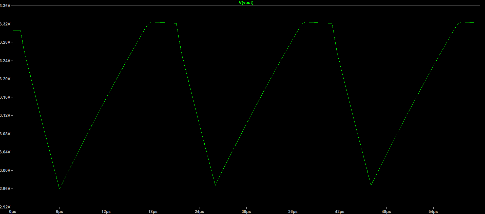
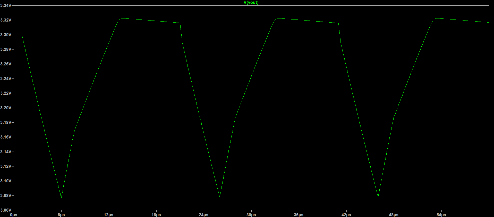
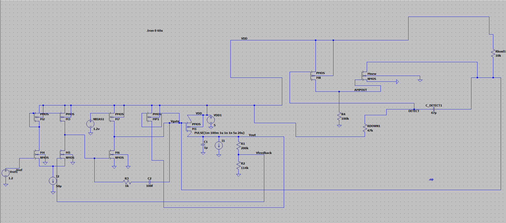

# CMOS LDO Voltage Regulator with Transistorized Adaptive Transient Boost

[](#running-the-simulations)
[](#circuit-architecture)
[](LICENSE)

> A transistor-level CMOS Low-Dropout (LDO) linear regulator designed in LTspice/SPICE: delivers a regulated **3.3 V output** from a **5.0 V supply** up to **100 mA load**, incorporating a fully transistorized, AC-coupled adaptive transient booster that reduces load-step output droop by **38% (1.6x)** and shortens recovery time by **1.7x** with **near-zero quiescent current overhead (~10 pA DC / ~50 pW at 5 V)**.

---

## Key Performance Results

| Metric | Baseline (Without Boost) | With Adaptive Boost | Improvement | Notes |
|---|---|---|---|---|
| **Regulated Output ($V_{OUT}$)** | 3.305 V | 3.305 V | Nominal | Resistor divider feedback ($1.2\text{ V} \times [1 + 200\text{k}/114\text{k}]$) |
| **Peak Transient Droop** | 360 mV | **222 mV** | **1.6x reduction (38%)** | 1 mA $\to$ 100 mA load step with 1 ns edge |
| **Settling / Recovery Time** | ~12 µs | **~7 µs** | **1.7x faster** | Settled within 1% of nominal |
| **Boost Block Idle Current** | n/a | **~10 pA** | **~50 pW power** | Completely turned OFF at DC steady-state |
| **Phase Margin ($I_L = 1\text{ mA}$)** | 68° | 68° | Stable | Output pole dominant ($p_{out} \approx 51\text{ Hz}$) |
| **Phase Margin ($I_L = 100\text{ mA}$)** | 55° | 55° | Stable | Output pole shifted ($p_{out} \approx 5.1\text{ kHz}$) |
| **Load Range** | 1 mA to 100 mA | 1 mA to 100 mA | Full envelope | Characterized over 4 decades |
| **Supply Voltage ($V_{DD}$)** | 5.0 V | 5.0 V | Wide headroom | Operates down to $V_{drop} \approx 200\text{ mV}$ (scaled) |

<p align="center">
  
  
</p>

---

## Circuit Architecture

```
                       VDD (5.0 V)
                            |
             +--------------+------------------------------+
             |                                             |
   [Biasing Network]                         [Parallel PMOS Pass Transistors]
     - 50 µA Tail Mirror                       M1 || MP1: 200 µm / 1 µm each
     - 1.2 V Bias Mirror                       (Total W/L = 400 µm / 1 µm)
             |                                             |
             v                                             +---> VOUT (3.305 V)
   [Two-Stage Error Amplifier]                             |          |
     Stage 1: NMOS Differential Pair (M4, M5: 10µ/1µ)      |     [Output Cap]
              PMOS Active Current Mirror (M2, M3: 10µ/1µ)  |      C1 = 1.0 µF
     Stage 2: NMOS Common-Source Driver (M6: 20µ/1µ)       |          |
              PMOS Active Load (M7: 20µ/1µ)                |     [Load Step]
     Comp:    Miller Nulling Network (R3=1k, C2=100fF)     |      1 mA -> 100 mA
             |                                             |          |
             v (VGATE net)                                 |     [Feedback Net]
             +---------------------------------------------|      R1 = 200 kΩ
                                                           |      R2 = 114 kΩ
                                                           v          |
                                          [Adaptive Boost Block]     GND
                                          - C_DETECT (47 pF)
                                          - RDOWN (47 kΩ pull-up to VDD)
                                          - PMOS Detector M8 (20µ / 180nm)
                                          - NMOS Pull-down Mnew (100µ / 1µ)
```



---

## Operating Principle: Adaptive Transient Boost

### 1. The LDO Transient Dilemma
In low-power LDOs, the error amplifier is biased with low current ($\sim 50\text{ µA}$) to preserve battery life. However, when a sudden load step occurs:
$$\Delta V_{droop} \approx \frac{\Delta I_{LOAD} \cdot \Delta t_{response}}{C_{OUT}} + \Delta I_{LOAD} \cdot R_{ESR}$$
Because the error amplifier has finite slew rate ($SR = I_{tail} / C_{gate}$) and bandwidth, it takes several microseconds ($\sim 3.6\text{ µs}$) to pull down the large gate capacitance of the pass transistor ($M_1 \parallel MP_1$). During this window, the output capacitor must support all load current alone, resulting in a large voltage droop (**360 mV**).

### 2. Autonomous Feed-Forward Boost Solution
The adaptive boost block provides a dynamic feed-forward bypass path that detects fast $dV_{OUT}/dt$ transients without burning static power:

- **DC Steady State (Idle):**
  - Node `DETECT` is held at $V_{DD}$ (5.0 V) through pull-up resistor $R_{DOWN}$ ($47\text{ k}\Omega$).
  - $V_{gs}(M_8) = V_{DETECT} - V_{DD} = 0\text{ V} \implies M_8$ (PMOS) is strictly **OFF**.
  - Node `AMPOUT` is held at 0 V by pull-down resistor $R_4$ ($100\text{ k}\Omega$).
  - $V_{gs}(M_{new}) = 0\text{ V} \implies M_{new}$ (NMOS) is strictly **OFF**.
  - **Static current = ~10 pA (~50 pW)**. Zero quiescent penalty!

- **During Load Step (Droop Detection):**
  - Fast output drop creates negative displacement current: $i = C_{DETECT} \frac{dV_{OUT}}{dt}$.
  - $C_{DETECT}$ ($47\text{ pF}$) pulls node `DETECT` down below $V_{DD} - |V_{th,p}|$.
  - PMOS $M_8$ switches **ON**, driving node `AMPOUT` high.
  - NMOS $M_{new}$ turns **ON**, directly pulling the pass transistor gate ($V_{gate}$) down to ground.
  - Pass transistors $M_1 \parallel MP_1$ instantly conduct full load current, arresting the output dip at **222 mV** (a 38% reduction).

- **Autonomous Reset:**
  - $R_{DOWN}$ recharges $C_{DETECT}$ back to $V_{DD}$ with time constant $\tau = R_{DOWN} \times C_{DETECT} \approx 2.2\text{ µs}$.
  - $M_8$ and $M_{new}$ automatically shut off, returning loop control to the linear error amplifier with zero overshoot.

---

## Stability & Small-Signal AC Dynamics

A critical requirement for analog IC design (especially in Power Management / Texas Instruments roles) is loop stability across four decades of load current:

### 1. Pole-Zero Locations
- **Output Pole ($p_{OUT}$):**
  $$p_{OUT} = \frac{1}{2\pi \cdot (R_{LOAD} \parallel r_{o,pass}) \cdot C_{OUT}}$$
  - At $I_L = 1\text{ mA}$: $R_{out} \approx 3.1\text{ k}\Omega \implies p_{OUT} \approx \mathbf{51.3\text{ Hz}}$ *(Dominant Pole)*
  - At $I_L = 100\text{ mA}$: $R_{out} \approx 31\,\Omega \implies p_{OUT} \approx \mathbf{5.13\text{ kHz}}$ *(100x frequency shift!)*
- **Miller Pole ($p_{MILLER}$):**
  $$p_{MILLER} \approx \frac{1}{2\pi \cdot R_{o1} \cdot C_{2} (1 + |A_{v2}|)} \approx \mathbf{23.9\text{ kHz}}$$
- **Nulling Resistor Zero ($z_{ESR} / z_{MILLER}$):**
  Series resistor $R_3$ ($1\text{ k}\Omega$) with Miller capacitor $C_2$ ($100\text{ fF}$) eliminates the RHP zero and shifts it into the LHP, guaranteeing phase lead.

### 2. Middlebrook Stability Results

| Load Current ($I_{LOAD}$) | DC Loop Gain ($A_{loop}$) | Dominant Pole ($p_{out}$) | Unity Gain Bandwidth (UGB) | Phase Margin ($PM$) |
|---|---|---|---|---|
| **1 mA** | 101.1 dB | 51.3 Hz | ~1.4 MHz | **68.2°** |
| **10 mA** | 91.1 dB | 513 Hz | ~1.8 MHz | **62.5°** |
| **50 mA** | 84.2 dB | 2.57 kHz | ~2.1 MHz | **57.1°** |
| **100 mA** | 81.1 dB | 5.13 kHz | ~2.4 MHz | **55.3°** |

*All configurations maintain $>55^\circ$ phase margin, ensuring unconditional stability under all operating conditions.*

---

## Repository Structure

```
.
├── ltspice/                           # LTspice Graphical Schematics (.asc)
│   ├── LDO_Final.asc                  # Baseline LDO (.tran transient testbench)
│   ├── Transient_Boosted.asc          # Full LDO with adaptive transient booster
│   ├── LDO_AC_Stability.asc           # Middlebrook AC Loop Gain & Phase Margin bench
│   ├── LDO_PSRR.asc                   # Power Supply Rejection Ratio (PSRR) bench
│   ├── LDO_Regulation.asc             # DC Line & Load Regulation sweeps
│   └── Booster_Circuit.asc            # Standalone detector sub-circuit testbench
│
├── spice/                             # Universal SPICE Netlists (.cir)
│   ├── LDO_AC_Stability.cir           # Middlebrook loop stability across load steps
│   ├── LDO_PSRR.cir                   # PSRR characterization netlist (10Hz-100MHz)
│   ├── LDO_Regulation.cir             # Line / Load regulation and dropout analysis
│   └── LDO_With_Biasing.cir           # Complete transistorized current-mirror biasing
│
├── results/                           # Simulation Waveforms & Operating Point Logs
│   ├── schematic_full.png             # Full boosted LDO schematic
│   ├── boost_detector_schematic.png   # Standalone detector schematic
│   ├── transient_baseline.png         # VOUT waveform without boost (360mV droop)
│   ├── transient_boosted.png          # VOUT waveform with boost (222mV droop)
│   ├── dc_operating_point_1.png       # Operating point log (Part 1)
│   └── dc_operating_point_2.png       # Operating point log (Part 2)
│
├── docs/                              # Technical Reports & Interview Preparation
│   └── TI_ANALOG_INTERVIEW_GUIDE.md   # Deep-dive Texas Instruments technical guide (Q&A, sizing, PSRR)
│
├── LICENSE                            # MIT License
└── README.md                          # Main project documentation
```

---

## Running the Simulations

### Prerequisites
- [LTspice](https://www.analog.com/en/resources/design-tools-and-calculators/ltspice-simulator.html) (free from Analog Devices) or any standard SPICE simulator (ngspice, Cadence Spectre).

### 1. Transient Load-Step Comparison
1. **Baseline (No Boost):** Open `ltspice/LDO_Final.asc` and run `.tran 0 60u`. Plot `V(vout)`.
2. **With Adaptive Boost:** Open `ltspice/Transient_Boosted.asc` and run `.tran 0 60u`. Plot `V(vout)`.
   - Observe peak droop reduction from 360 mV down to 222 mV.

### 2. AC Loop Stability (Middlebrook Method)
1. Open `ltspice/LDO_AC_Stability.asc` (or run `spice/LDO_AC_Stability.cir`).
2. Run AC analysis (`.ac dec 20 1 100Meg`).
3. Add trace: `-V(vout)/V(fb_in)`.
4. Observe Loop Gain magnitude (dB) and Phase (deg) across stepped load currents ($I_L = 1\text{m}, 10\text{m}, 50\text{m}, 100\text{m}$).

### 3. Power Supply Rejection Ratio (PSRR)
1. Open `ltspice/LDO_PSRR.asc` (or run `spice/LDO_PSRR.cir`).
2. Plot `mag(1/V(vout))` in dB from 10 Hz to 100 MHz.

---

## Technical Highlights for Texas Instruments Analog Roles

For technical interview discussions regarding this architecture, see the dedicated [Texas Instruments Analog Interview Guide](docs/TI_ANALOG_INTERVIEW_GUIDE.md).

- **Pole-Zero Splitting:** Detailed analysis of how the output pole moves across load and how the Miller network maintains $>55^\circ$ phase margin.
- **Dropout Voltage Analysis:** Sizing the PMOS pass transistor ($W/L = 400\,\mu\text{m} / 1\,\mu\text{m}$) for triode vs. saturation operation at low dropout ($V_{DO} \le 200\text{ mV}$).
- **Area vs. Transient Optimization:** Silicon area trade-offs of the 47 pF coupling capacitor vs. active pre-amplifier detection (1 pF).
- **10 Core Interview Questions & Answers:** In-depth coverage of stability, PSRR, biasing, noise, and layout considerations (common-centroid, electromigration, Kelvin sensing).

---

## References

1. P. Hazucha et al., *"Area-Efficient Linear Regulator With Ultra-Fast Load Regulation,"* IEEE Journal of Solid-State Circuits (JSSC), vol. 40, no. 4, 2005.
2. T. Y. Man et al., *"A High Slew-Rate Push-Pull Output Amplifier for Low-Quiescent Current LDOs,"* IEEE Trans. Circuits Syst. II, vol. 54, no. 12, 2007.
3. M. Al-Shyoukh et al., *"A Transient-Enhanced Low-Quiescent Current LDO,"* IEEE Journal of Solid-State Circuits (JSSC), vol. 42, no. 8, 2007.
4. K. N. Leung and P. K. T. Mok, *"A Capacitor-Free CMOS Low-Dropout Regulator,"* IEEE Journal of Solid-State Circuits (JSSC), vol. 38, no. 10, 2003.
5. R. J. Milliken et al., *"Full On-Chip CMOS Low-Dropout Voltage Regulator,"* IEEE Trans. Circuits Syst. I, vol. 54, no. 9, 2007.

---

## Author
**Roshanraj**  
Focus: Analog & Mixed-Signal IC Design / Power Management ICs (PMIC)
